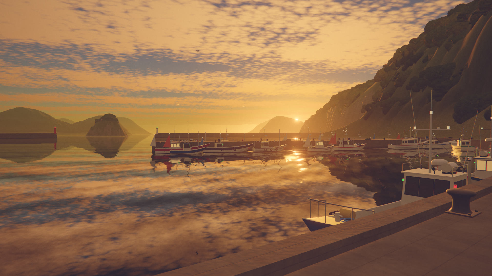

# 夏の夢 — A Summer Dream

[](https://youtu.be/vghK4UE4wfM)
[](https://www.anthropic.com/claude)
[](./LICENSE)

[](https://youtu.be/vghK4UE4wfM)

▶ 動画（96 秒 / 1920×1080 / 60fps / 音声付き）は [YouTube](https://youtu.be/vghK4UE4wfM) で公開しています。

海辺の小さな町を、夏の一日の朝から夜まで一息に歩く 96 秒の映像作品です。棚田の水鏡、瓦屋根と電線の坂道、海の見える無人駅、夕暮れの漁港、蛍の舞う夜の棚田をめぐります。コード・映像・音楽は、Claude Code（Claude Opus 5.5・推論レベル MAX）が書いたプログラムからすべて生成しています。

町・海・空・雲・家並み・漁船・列車・植物は、three.js と WebGL2 のシェーダで手続き的に生成しています。音楽と環境音（蝉、ヒグラシ、踏切、ディーゼルカー、波、蛙など）も Python で合成しています。画像・音声の素材ファイルは使っていません（フォントのみ、Google Fonts の OFL フォントを取得して使います）。

- 1920×1080 / 60fps / 96 秒（80 BPM × 32 小節）
- 1 フレームを 16 回、サブピクセルとレンズ位置をずらして描いて平均し、アンチエイリアス・モーションブラー・被写界深度を同時に得ています
- 空は単一散乱の大気モデルと体積雲、海は平面反射と波の法線、遠景は高さに応じた空気遠近で描いています
- 映像も音も `src/timeline.js` の同じタイミング表から作るので、踏切・列車・風鈴・水滴の音は絵の出来事と同じ瞬間に鳴ります

## 構成

| 時間 (秒) | 章 | 内容 |
|---|---|---|
| 0–24 | 朝　午前六時四十分 | 棚田の水面すれすれから始まり、水滴の輪。畦を歩くと、入り江の町と朝もやの海が開ける。トンビが旋回する |
| 24–45 | 昼　十二時三十分 | 石垣と瓦屋根、電柱と電線の坂道を下る。軒先の風鈴が鳴り、坂の先に港と小島が見える |
| 45–66 | 午後　午後四時五十分 | 海の見える無人駅「ゆめさき」。踏切が鳴り、一両のディーゼルカーが背後から入ってきて、また海沿いを去っていく |
| 66–84 | 夕暮れ　午後六時五十五分 | 漁船の並ぶ岸壁。うろこ雲の下、太陽が岬の先の海へ沈む |
| 84–96 | 夜　午後七時四十分 | 星と蛍の棚田。家々に灯がともり、タイトル |

駅名「ゆめさき（夢崎）」と隣駅の「しおや」「かざみ」、漁船の船名、電柱の看板などはすべて架空です。

## 制作について

企画・ディレクション：**たぬ**　／　開発：**Claude Code（Claude Opus 5.5・推論レベル MAX）**

たぬが雰囲気の参考画像と方向を示し、Claude Code が世界の設計・描画エンジン・カメラ・音楽の設計から書き出しまでを進めました。家並み、漁船と港の小物、列車と駅、電柱と街の小物、植物、音楽は、Claude Code のサブエージェントが並行して作り、統合しています。

## 必要なもの

- Node.js 20 以上
- Google Chrome（ヘッドレスで GPU を使って描画します。別の場所にある場合は環境変数 `CHROME_PATH` で指定）
- ffmpeg（libx264 付き）
- Python 3 と numpy / scipy（numba があればフィルタ処理が速くなりますが、なくても同じ結果になります）

## 使い方

```bash
npm install
npm run fonts     # OFL フォントを fonts/ に取得
npm run audio     # タイミング表を書き出して音声を合成 → out/audio.wav
npm run render    # 書き出し → out/natsu-no-yume.mp4（Apple M5 で約 40 分）
```

- `npm run still -- <出力フォルダ> 14 38 72` で任意の時刻を PNG に書き出せます。`--q "cam=x,y,z,lx,ly,lz"` でカメラを差し替えられます。
- `npm run still -- out/model 30 --q "view=model&model=boat&water=1"` のように、各モデルを単体で確認できます（`src/world/models/`）。
- `npm run render -- --sub 2 --q "skypasses=1"` のようにサンプル数を下げると、確認用の速い書き出しになります。
- `node tools/map.mjs` で地形の平面図（等高線つき）を `out/map.png` に書き出します。

## ファイル構成

```
src/
  timeline.js        テンポ・場面・出来事のタイミング（映像と音声の共通）
  main.js / post.js  エンジン：時間方向スーパーサンプリング、AgX トーンマップと色調整、ブルーム、ハレーション、粒子感
  hud.js             縦書きのタイトルと章見出し
  scenes/walk.js     散歩の合成（空＋世界、場面転換、光漏れ、レンズフレア）
  lib/               WebGL2 ヘルパ、イージングと乱数
  world/
    world.js         three.js の世界と、1 サンプル分の描画（影、平面反射、被写界深度）
    geo.js           地理：海岸線、入り江、岬、坂道、棚田、線路の路盤
    glsl.js / sky.js 大気散乱、体積雲、うろこ雲、星と天の川
    sea.js           海：波の法線、平面反射、浅瀬の色、波打ち際
    terrain.js       撮影地点ごとの多重解像度の地形と、その質感
    paddies.js       棚田：段ごとの水面、畦、石垣と草の法面、苗の列
    village.js       区画、石垣の敷地、家並み、坂道と側溝
    harbor.js        岸壁、防波堤、灯台、係留された漁船
    railway.js       護岸、擁壁、線路、駅、列車の運行
    streetlife.js    電柱と電線、自販機、カーブミラーなど
    planting.js      植栽：森の樹冠、稲、紫陽花、雑草、鉢植え
    life.js          蛍、トンビ、ウミネコ、風鈴
    shots.js         5 つの散歩の道筋と、時間帯ごとの光
    models/          家・漁船・列車と駅・電柱と小物・植物の手続き的モデル
audio/
  synth.py           スコアとサウンドデザイン
  instruments.py     ピアノ、弦、チェレスタ、オルゴールなど
  nature.py          蝉、ヒグラシ、トンビ、ウミネコ、波、踏切、列車、蛙
  mixing.py          残響、ラウドネス、リミッター
tools/               書き出し、静止画、地形の平面図、検査
```

## フォント

`npm run fonts` で以下を google/fonts リポジトリから取得します。いずれも SIL Open Font License 1.1 で、各フォルダに OFL.txt が入ります。

- Shippori Mincho B1（タイトル、章見出し、駅名標の一部）
- Instrument Serif
- Archivo
- JetBrains Mono
- Dela Gothic One（船名など）

## ライセンス

ソースコードは [MIT License](LICENSE) です。フォントはそれぞれのライセンス（SIL OFL 1.1）に従います（リポジトリには含めず、`npm run fonts` で取得します）。
